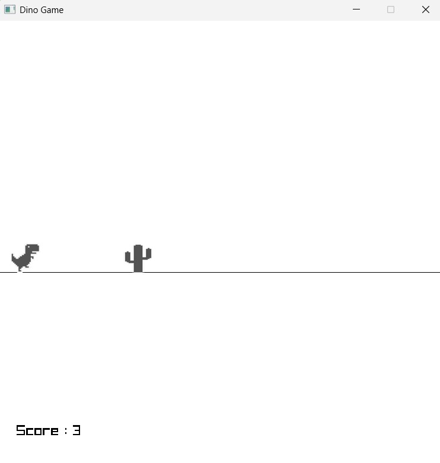
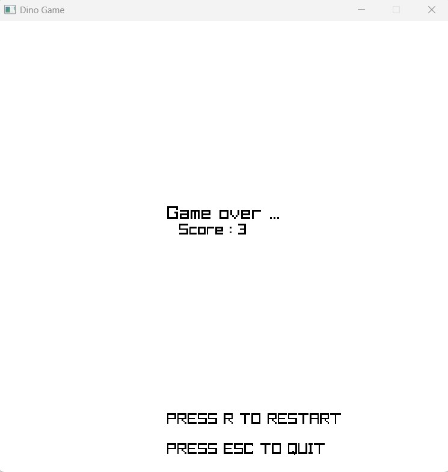

# 🦖 Dino Game using Python and Pyray

A simple recreation of the classic **Chrome Dino Game** built using **Python** and the **Pyray** graphics library. This project demonstrates fundamental game development concepts such as game loops, gravity-based movement, collision detection, score tracking, obstacle generation, and game state management.

---

# 📸 Preview



---

# ✨ Features

* Classic Chrome Dino-inspired gameplay
* Gravity-based jumping physics
* Randomly generated small and large cactus obstacles
* Collision detection using rectangles
* Score tracking
* Game Over screen
* Restart the game by pressing **R**
* Exit anytime using **ESC**

---

# 🛠 Technologies Used

* Python 3
* Pyray (Python bindings for raylib)
* Random module

---

# 📂 Project Structure

```text
Dino-Game/
│
├── dino_game.py
├── DinoRun1.png
├── SmallCactus1.png
├── LargeCactus1.png
├── README.md
└── screenshot1.jpg
└── screenshot2.jpg
```

---

# 🚀 Installation

## Clone the repository

```bash
git clone https://github.com/S-Vikram2008/Dino-game.git
```

Move into the project folder.

```bash
cd Dino-game
```

Install Pyray.

```bash
pip install pyray
```

Run the game.

```bash
python dino_game.py
```

---

# 🎮 Controls

| **Key** | **Action**              |
| ------- | ----------------------- |
| Space   | Jump                    |
| R       | Restart after Game Over |
| ESC     | Exit the game           |

---

# 🎯 Objective

Control the dinosaur and jump over incoming cactus obstacles.

For every obstacle successfully crossed:

* Score increases by **1**
* A new obstacle is generated
* The game gradually continues with endless obstacles

The game ends if the dinosaur collides with any cactus.

---

# 🧠 Game Logic

The game consists of two major functions.

## 1. `game()`

This is the main game loop.

It is responsible for:

* Handling keyboard input
* Applying gravity and jump physics
* Moving obstacles
* Drawing the game objects
* Collision detection
* Score calculation
* Generating new obstacles

The function runs continuously until the player collides with an obstacle.

---

## 2. `game_over(score)`

This function displays the Game Over screen.

It shows:

* Final Score
* Restart instruction
* Exit instruction

Pressing **R** starts a completely new game.

---

# 🦖 Dinosaur Jump Physics

The dinosaur moves using **velocity** and **gravity**.

When the player presses **Space**:

```python
velocity = -12
```

Each frame:

```python
velocity += gravity
dino_y += velocity
```

Gravity gradually pulls the dinosaur back to the ground, creating a smooth jumping effect.

---

# 🌵 Obstacle Generation

Obstacles are stored as Python dictionaries inside a list.

Example:

```python
obstacles = [
    {
        "x": 720,
        "size": 20,
        "passed": False
    }
]
```

Each obstacle stores:

* X-coordinate
* Obstacle size
* Whether it has already been counted for the score

When the last obstacle moves sufficiently left, a new random obstacle is added.

---

# 🏃 Obstacle Movement

Every frame, each obstacle moves towards the dinosaur.

```python
obstacle["x"] -= 10
```

When an obstacle leaves the screen, it is removed from the list to free memory.

---

# 💥 Collision Detection

Both the dinosaur and obstacles are represented using rectangles.

```python
dino_rec = pr.Rectangle(...)
obstacle_rec = pr.Rectangle(...)
```

Collision is detected using:

```python
pr.check_collision_recs()
```

If a collision occurs, the game immediately displays the Game Over screen.

---

# 🏆 Score System

Every obstacle successfully crossed increases the score.

```python
score += 1
```

Each obstacle is counted only once using the `passed` flag.

The current score is displayed continuously on the screen.

---

# 🔄 Restart Mechanism

After Game Over,

Press:

```text
R
```

to restart.

The game creates:

* New dinosaur state
* New obstacle list
* Score = 0

without restarting the application.

---

# 🎨 Rendering

Every frame, the game draws:

1. Background
2. Ground line
3. Dinosaur
4. Obstacles
5. Score

This process repeats **50 times every second**.

---

# 📚 Concepts Demonstrated

This project demonstrates:

* Game Loop
* Frame Rate Control
* Keyboard Input
* Gravity-Based Physics
* Collision Detection
* Random Obstacle Generation
* Lists
* Dictionaries
* Conditional Statements
* Functions
* Rendering Graphics
* Score Tracking
* Game State Management

---

# 📈 Future Improvements

Possible enhancements include:

* Running animation
* Increasing game speed over time
* Sound effects
* High score saving
* Background scrolling
* Day/Night cycle
* Flying obstacles (birds)
* Pause menu
* Start menu
* Better graphics

---

# 🎓 What I Learned

While building this project, I learned:

* How game loops work
* How gravity-based movement is implemented
* How collision detection works
* How to manage game state
* How to generate obstacles randomly
* How to use lists and dictionaries to represent game objects
* How to draw graphics using Pyray
* How to implement a restart mechanism

---

# 📄 License

This project is open source and available under the MIT License.

---

# 👨‍💻 Author

**S. Vikram**

GitHub: **https://github.com/S-Vikram2008**
